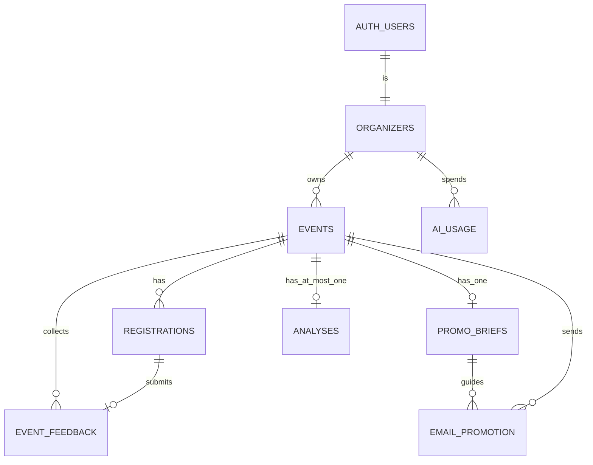

# Data model

The stored tables and the computed shapes of the Event Planner, in [GLOSSARY.md](../GLOSSARY.md) terms. Database is Supabase (Postgres).

**Source of truth.** `supabase/migrations/` is authoritative once it exists; `supabase gen types typescript` writes `packages/db-types`, which `web` and `server` import. If this document and a migration disagree, the migration wins and this document is fixed.

## Conventions

- Primary keys are `uuid`. Every table has `created_at` and `updated_at` (`timestamptz`).
  - `id`: globally unique primary key for the row; used for foreign keys, and RLS without exposing sequential counts.
  - `created_at`: UTC timestamp when the record was created; used for auditability, chronological sorting, and timing metrics.
  - `updated_at`: UTC timestamp of the last modification; used for change tracking and debugging.
- Enumerated values are Postgres enums:
  - `event_status`: `draft` | `upcoming` | `completed`
  - `event_format`: `online` | `in_person` | `hybrid`
  - `event_category`: `educational` | `brand_promotion` | `tech` | `wellness_and_fitness` | `others`
  - `registration_source`: `email` | `social` | `referral` | `other`
  - `ai_usage_type`: `analysis` | `comparison` | `promo` | `revision`
- Monetary amounts (`ticket_price`, `revenue`) are `numeric(12,2)`. The MVP assumes a single currency, so there is no currency column.
- Access: browsers use the Organizer's Supabase session and row-level security (RLS). The `server` uses the `service_role` key, which only it holds. There are no anonymous policies on any table (ADR 0002).

## Relationships



A Comparison is not stored (see [Derived shapes](#derived-shapes)).

## Tables

### `organizers`

**Purpose.** An Organizer account that creates, promotes, runs, and analyzes events—including a Guest Sandbox owner trying the app without a permanent sign-up. Supabase Auth owns `auth.users`; guest login uses anonymous sign-ins, so a guest is a real, throwaway auth user. This table is the RLS tenant boundary: every owned row cascades when the organizer (or guest) is deleted.

| Field | Type | Required | Meaning | Why we need it |
| --- | --- | --- | --- | --- |
| `id` | uuid | yes | PK, FK to `auth.users(id)`, `on delete cascade` | Links application data to the authenticated session; deleting the auth user cascades and removes all owned rows (events, registrations, promotions, feedback, AI usage). |
| `is_guest` | boolean | yes | `true` for anonymous sandbox sign-ins; `false` for registered organizers | Distinguishes throwaway sandbox accounts so the app can enforce stricter AI rate limits, seed sample events, and prompt guests to sign up to keep their work. |
| `expires_at` | timestamptz | no | `now + 24h` for guests; `null` for registered organizers | Tells the scheduled `pg_cron` cleanup job when a guest account (and all cascaded data) can be purged so demo data does not accumulate. |

**Invariants**
- A row is created by a trigger on `auth.users` insert (trigger).
- A scheduled `pg_cron` job deletes the auth users of expired guests; every owned row cascades (cron + FK).
- Guests are seeded with sample Events: two Completed, one Upcoming (seed step, slice 5).

**Access:** owner only.

### `events`

| Field | Type | Required | Meaning | Why we need it |
| --- | --- | --- | --- | --- |
| `organizer_id` | uuid | yes | FK to `organizers`, cascade | Ownership and RLS scoping; enables comparing events across one organizer's history. |
| `name` | text | yes | Human-readable title of the event | Display across UI, promotions, and AI narratives. |
| `starts_at` | timestamptz | to leave Draft | Exact UTC start date and time; null while Draft | Scheduling, countdowns, lead-time calculations, and chronological comparisons. |
| `ends_at` | timestamptz | to leave Draft | Exact UTC end date and time; null while Draft | Computes event duration and defines when the event window closes; must be after `starts_at`. |
| `timezone` | text | yes | IANA zone name, for example `America/Chicago` | Renders local date/time accurately and supports day-of-week / time-of-day analysis in local time. |
| `location` | text | yes | Physical address or meeting/conference URL | Tells attendees where to go or how to join|
| `format` | event_format | yes | `online` \| `in_person` \| `hybrid`; default `in_person` | Major quantitative variable for turnout and show-up rate comparisons across formats. |
| `description` | text | no | Free-text summary of what the event covers | Context for attendees, promo copy generation, and AI post-event analysis. |
| `category` | event_category | yes | `educational` \| `brand_promotion` \| `tech` \| `wellness_and_fitness` \| `others` | Enables apples-to-apples benchmarking within the same event type. |
| `target_attendance` | integer | yes | Expected / goal headcount, `>= 0` | Baseline for success: `performanceVsTarget = attendees / target_attendance`. |
| `registration_link` | text | no | External sign-up URL; the app does not host sign-up | Included in generated promotions (`PromoGateResult` checks this) when registration is external. |
| `status` | event_status | yes | `draft` \| `upcoming` \| `completed`; default `draft` | Enforces workflow integrity so historical analytics cannot be corrupted after an event ends. |
| `ticket_price` | numeric(12,2) | yes | Flat face-value price per ticket, `>= 0`; default `0` (free) | Separates free vs. paid turnout behavior |
| `revenue` | numeric(12,2) | no | Optional organizer-entered actual revenue on completion, `>= 0` | Source for `EventFigures.totalRevenue`; remains null until actual revenue is entered. |

**Invariants**
- `starts_at`, `ends_at`, and `location` must be non-null and `ends_at > starts_at` before `status` leaves `draft` (check constraint).
- Moving to `completed` locks that Event's Registrations and Check-ins (trigger).
- Moving from `completed` back to `upcoming` is allowed only while no `analyses` row exists (trigger).
- Deleting is allowed only in `draft`; Completed Events can never be deleted (trigger or policy, per build plan slices 1 and 5).
- Editing `name`, `starts_at`, `ends_at`, `location`, `format`, `category`, `target_attendance`, `ticket_price`, or `revenue` on a completed Event sets `analyses.stale = true` (trigger).

**Stretch Goals**
- `self_checkin_enabled` (boolean): organizer switch for public Self Check-in; out of MVP scope.
- `checkin_token` (text): server-generated capability token for Self Check-in URL/QR; out of MVP scope.

**Access:** owner only.

### `registrations`

**Purpose.** One person's sign-up and attendance outcome for one specific event. This is the primary quantitative fact table for demand (registrations), conversion (checked-in attendees), channel performance (`source`), and audience composition (`segment`).

| Field | Type | Required | Meaning | Why we need it |
| --- | --- | --- | --- | --- |
| `event_id` | uuid | yes | FK to `events`, cascade | Associates the registration with a specific event. |
| `registration_id` | text | yes | 6-character app-generated code using an unambiguous alphabet | Human-friendly confirmation / lookup code for check-in and feedback. |
| `date` | date | yes | Date the attendee registered for the event | Enables registration velocity and lead-time analysis (correlating sign-up spikes with promotion dates and `events.starts_at`). |
| `name` | text | yes | Registrant's full or display name (not unique) | Identifies the attendee for check-in lookup and organizer rosters. |
| `email_id` | text | no | Registrant's email address | Supports attendee outreach, confirmation/feedback follow-ups, and optional deduplication within an event. |
| `source` | registration_source | no | `email` \| `social` \| `referral` \| `other`; null reads as `"unknown"` | Acquisition attribution—shows which channel drives sign-ups and show-ups. |
| `segment` | text | no | Free-text cohort tag for this event, for example `"student"` | Lets organizers see who is showing up vs. no-showing so they can refine targeting. |
| `checked_in_at` | timestamptz | no | UTC timestamp when checked in; null means not checked in / no-show | Distinguishes registrations from actual attendees and supports attendance rate metrics. |

**Invariants**
- `unique (event_id, registration_id)` (constraint).
- `name` is not unique; multiple registrants may share a name.
- A second Check-in on a checked-in Registration is rejected or a no-op, never a second timestamp (server and trigger).
- Only the Organizer can clear `checked_in_at` (reversal).
- Writes are blocked once the Event is `completed` (trigger).

**Stretch Goals**
- `checked_in_via` (`organizer` \| `self`): how check-in was recorded; deferred with Self Check-in.
- An `attendees` table (profiles, demographics, repeat-attendee tracking) is deferred to Phase 2.

**Access:** owner only, checked through `events.organizer_id`. Public Self Check-in (Stretch Goal) never touches this table directly.

### `promo_briefs`

**Purpose.** Captures the organizer's expectations and marketing inputs for the `email_promotion` they want to send to their audience (at most one brief per event). Guides AI email generation and records the organizer's strategic intent (`audience`, `purpose`, `tone`, `call_to_action`) for post-event evaluation.

| Field | Type | Required | Meaning | Why we need it |
| --- | --- | --- | --- | --- |
| `event_id` | uuid | yes | FK to `events`, cascade, **unique** | Links the brief to its event (1:0..1 per event). |
| `date` | date | yes | Planned launch or target send date for the email promotion | Measures promotion runway before `events.starts_at` and correlates outreach timing with registration spikes. |
| `audience` | text | yes | Target audience persona or segment | Guides AI email copy and compares intended audience to actual `registrations.segment`. |
| `purpose` | text | yes | Goal or value proposition of the email promotion | Anchors messaging clarity and helps evaluate whether the value prop resonated. |
| `tone` | text | yes | Desired voice or style (for example friendly, formal, urgent) | Qualitative variable to correlate with email-driven engagement and turnout. |
| `call_to_action` | text | yes | Desired action the recipient should take | Clarifies the conversion hook used in email outreach. |

**Invariants**
- `unique (event_id, id)` supports the composite foreign key from `email_promotion` and ensures its brief belongs to the same event.

**Access:** owner only, through `events`.

### `email_promotion`

**Purpose.** An email promotional campaign generated or written for an event based on its `promo_briefs` expectations. One event may send multiple email promotions over time (launch, early-bird, reminder) so organizers can correlate send dates with registration spikes.

| Field | Type | Required | Meaning | Why we need it |
| --- | --- | --- | --- | --- |
| `event_id` | uuid | yes | FK to `events`, cascade | Links the email promo to its event (1-to-many; not unique). |
| `promo_brief_id` | uuid | no | Part of composite FK `(event_id, promo_brief_id)` to `promo_briefs(event_id, id)`; `on delete set null` for `promo_brief_id` only | Links the generated/sent email back to the organizer's `promo_briefs` expectations that shaped it and ensures the brief belongs to the same event. |
| `date` | date | yes | Scheduled or send date of this email promo | Timeline correlation between email waves and registration spikes. |
| `email_subject` | text | yes | Generated or edited subject line | Key driver of email open rates and email-sourced registrations. |
| `email_body` | text | yes | Generated or edited email body | Ready-to-send outreach artifact. |
| `revision_instruction` | text | no | Organizer instruction for an AI edit, for example `"make it shorter"` | Explains how the email was refined; used as input for regeneration. |

**Invariants**
- Editing or regenerating updates the row in place (no versioning in MVP).
- A failed AI call leaves the row unchanged (server).

**Stretch Goals**
- Versioning and `origin` tracking (`generated` \| `ai_revision` \| `manual`) deferred out of MVP.

**Access:** owner can read and write; the server also writes (AI-generated content).

### `event_feedback`

**Purpose.** A post-event feedback submission capturing an attendee's overall rating, qualitative highlights, and repeat intent. Together with quantitative `EventFigures`, this explains *why* an event succeeded or failed and feeds AI narratives in `analyses`.

| Field | Type | Required | Meaning | Why we need it |
| --- | --- | --- | --- | --- |
| `event_id` | uuid | yes | FK to `events`, cascade | Associates feedback with the event being reviewed. |
| `registration_id` | text | yes | Part of composite FK `(event_id, registration_id)` to `registrations(event_id, registration_id)`, `on delete cascade` | Links each feedback submission to a registration so feedback can be sliced by `source` and `segment`; each registration can submit at most one response. |
| `overall_rating` | smallint | yes | Overall satisfaction score from `1` to `5` | Core quantitative quality signal for event success/failure. |
| `highlights` | text | no | Free-text takeaway on what worked or stood out | Qualitative signal for AI theme extraction and organizer learning. |
| `would_attend_again` | boolean | no | Whether the respondent would attend a similar event again | Leading retention / loyalty indicator. |

**Invariants**
- Check constraint: `overall_rating between 1 and 5`.
- Unique constraint: `unique (event_id, registration_id)`.
- Submitted via a server endpoint using `event_id` and the required 6-character `registration_id` once the event is `completed`. For a completed event, any linked registration may submit. The server verifies the registration belongs to the event.
- Inserting or updating feedback for a `completed` event sets `analyses.stale = true`.

**Access:** owner can read through `events.organizer_id`; submissions from registered attendees go through the server endpoint (`service_role`), never directly to the table (ADR 0002). Anonymous feedback is not supported.

### `analyses`

**Purpose.** The stored post-event AI performance review for a completed event (at most one per event). Caches expensive LLM output alongside the exact figures it was generated from so the organizer gets consistent insights and knows when the numbers have changed.

| Field | Type | Required | Meaning | Why we need it |
| --- | --- | --- | --- | --- |
| `event_id` | uuid | yes | FK to `events`, cascade, **unique** | Enforces at most one current analysis per completed event. |
| `narrative` | text | yes | AI-written qualitative interpretation of the event's performance | Translates raw numbers and feedback into actionable recommendations. |
| `figures` | jsonb | yes | Frozen snapshot of the `EventFigures` the narrative was written from | Keeps the narrative aligned with the numbers that produced it, even if event data changes later. |
| `generated_at` | timestamptz | yes | When the analysis was generated | Shows freshness to the user and aids debugging / regeneration tracking. |
| `stale` | boolean | yes | `true` if key inputs changed after `generated_at`; default `false` | Prompts the organizer to regenerate so they are not deciding from outdated text. |

**Invariants**
- At most one per Event. Regenerating replaces the row and resets `stale` to false (server, upsert).
- The Event must be `completed` (trigger).
- A failed AI call saves nothing (server).

**Access:** owner can read; writes come from the server.

### `ai_usage`

**Purpose.** Append-only log of AI calls per organizer. The rate cap is the number of rows in the last N hours, stricter for guests.

| Field | Type | Required | Meaning | Why we need it |
| --- | --- | --- | --- | --- |
| `organizer_id` | uuid | yes | FK to `organizers`, cascade | Attributes AI spend / quota to the right account. |
| `type` | ai_usage_type | yes | `analysis` \| `comparison` \| `promo` \| `revision` | Tracks which AI features are used and supports per-feature rate limits if needed. |

**Access:** server only. No client policies; written and read with `service_role`.

## Derived shapes

Never stored. These are the contract between `figures/` and the AI (ADR 0001) and between `server` and `web`. Shown as TypeScript sketches; the real definitions are Zod schemas in `server`.

```ts
type Source = "email" | "social" | "referral" | "other" | "unknown";

type SourceTurnout = {
  source: Source;            // "unknown" is an explicit row
  registrations: number;
  checkedIn: number;
};

type FeedbackSummary = {
  responseCount: number;
  avgOverallRating: number | null;       // null if responseCount is 0
  wouldAttendAgainRate: number | null;   // yes / answered; null if none answered
};

type EventFigures = {
  registrations: number;
  attendees: number;                 // checked-in Registrations
  attendanceRate: number | null;     // attendees / registrations; null if 0 registrations
  performanceVsTarget: number | null; // attendees / target_attendance; null if target is 0
  totalRevenue: number | null;       // mirrors events.revenue; null until actual revenue is entered
  turnoutBySource: SourceTurnout[];
  feedbackSummary: FeedbackSummary;
};

type Comparison = {
  events: { eventId: string; name: string; startsAt: string; figures: EventFigures }[]; // 2 to 5, all completed
  summary: string;                   // AI-written, not stored
};

type PromoGateResult =
  | { ok: true }
  | { ok: false; missing: ("startsAt" | "endsAt" | "registrationLink")[] };
```

### SubmitFeedback shape

Feedback from a registered attendee reaches data only through this server operation (ADR 0002). A registration code is required; anonymous feedback and a separate feedback token are not supported in MVP.

```ts
type SubmitFeedback =
  { in: {
      eventId: string;
      registrationId: string;         // required 6-character registrations.registration_id
      overallRating: number;          // 1..5
      highlights?: string;
      wouldAttendAgain?: boolean;
    } } &
  { out:
      | { status: "ok" }
      | { status: "closed" }          // event not open, registration unknown, or not eligible yet
      | { status: "already_submitted" } // registration already has feedback
  };
```

The server verifies `registrationId` belongs to `eventId`. For a completed event, a valid registration is sufficient.

### Self Check-in shapes

**Stretch Goal** — deferred along with Self Check-in (see `events` and `registrations`). Not part of the MVP.

The public page reaches data only through these three server operations (ADR 0002). They never return other people's data.

```ts
type Find =
  { in: { token: string; query: string } } &
  { out:
      | { status: "match"; registrationId: string; displayName: string; checkedIn: boolean }
      | { status: "ambiguous" }   // no names; ask for the Registration ID
      | { status: "none" }
      | { status: "closed" } };

type CheckIn =
  { in: { token: string; registrationId: string } } &
  { out: { status: "checked_in" | "already_checked_in" | "closed" } };

type SetSource =
  { in: { token: string; registrationId: string; source: Exclude<Source, "unknown"> } } &
  { out: { status: "ok" | "closed" } };
```

`closed` is one generic answer for a bad or rotated token, a non-Upcoming Event or a switched-off page, so the response does not reveal which.
