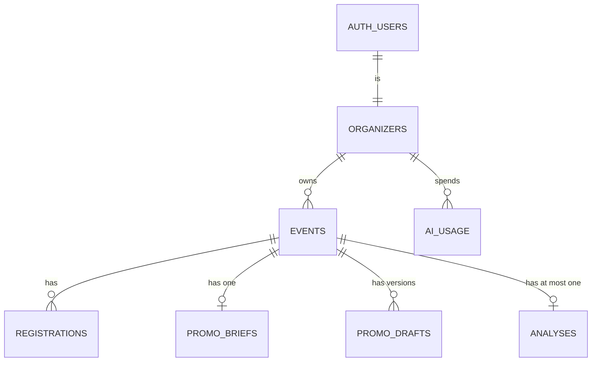

# Data model

The stored tables and the computed shapes of the Event Planner, in [GLOSSARY.md](../GLOSSARY.md) terms. Database is Supabase (Postgres). MVP only: contact and location-of-attendee fields belong to stretch goals and are left out on purpose.

**Source of truth.** `supabase/migrations/` is authoritative once it exists; `supabase gen types typescript` writes `packages/db-types`, which `web` and `server` import. If this document and a migration disagree, the migration wins and this document is fixed.

## Conventions

- Primary keys are `uuid`. Every table has `created_at` and `updated_at` (`timestamptz`).
- Enumerated values are Postgres enums: `event_status`, `registration_source`, `checkin_via`, `draft_origin`, `ai_usage_kind`.
- `revenue` is `numeric(12,2)`. The MVP assumes a single currency, so there is no currency column.
- Access: browsers use the Organizer's Supabase session and row-level security (RLS). The `server` uses the `service_role` key, which only it holds. There are no anonymous policies on any table (ADR 0002).

## Relationships



A Comparison is not stored (see [Derived shapes](#derived-shapes)).

## Tables

### `organizers`

An Organizer, including a Guest Sandbox owner. Supabase Auth owns `auth.users`; guest login uses anonymous sign-ins, so a guest is a real, throwaway auth user.

| Field | Type | Required | Notes |
| --- | --- | --- | --- |
| `id` | uuid | yes | PK, FK to `auth.users(id)`, `on delete cascade` |
| `is_guest` | boolean | yes | true for anonymous sign-ins |
| `expires_at` | timestamptz | no | set to now + 24h for guests; null for others |

**Invariants**
- A row is created by a trigger on `auth.users` insert (trigger).
- A scheduled `pg_cron` job deletes the auth users of expired guests; every owned row cascades (cron + FK).
- Guests are seeded with sample Events: two Completed, one Upcoming (seed step, slice 5).

**Access:** owner only.

### `events`

| Field | Type | Required | Notes |
| --- | --- | --- | --- |
| `organizer_id` | uuid | yes | FK to `organizers`, cascade |
| `name` | text | yes | |
| `starts_at` | timestamptz | to leave Draft | UTC; null while Draft |
| `timezone` | text | yes | IANA name, for example `America/Chicago` |
| `location` | text | to leave Draft | null while Draft |
| `description` | text | no | |
| `target` | integer | yes | expected attendance, `>= 0` |
| `registration_link` | text | no | external URL; the app does not host sign-up |
| `status` | event_status | yes | `draft` \| `upcoming` \| `completed`; default `draft` |
| `self_checkin_enabled` | boolean | yes | Organizer's switch; default false |
| `checkin_token` | text | yes | see invariants |
| `revenue` | numeric(12,2) | no | entered when completing; `>= 0` |

**Invariants**
- `starts_at` and `location` must be non-null before `status` leaves `draft` (check constraint).
- `checkin_token` is a unique, server-generated random string of 32 bytes or more, stored as plain text so the link or QR can be shown again. Rotation overwrites it; there is no history (unique index; server).
- Self Check-in is open only when `status = 'upcoming'` and `self_checkin_enabled` (enforced by the server).
- Moving to `completed` locks that Event's Registrations and Check-ins (trigger).
- Moving from `completed` back to `upcoming` is allowed only while no `analyses` row exists (trigger).
- Deleting is allowed only in `draft`; Completed Events can never be deleted (trigger or policy, per build plan slices 1 and 5).
- Editing `name`, `starts_at`, `location` or `target` on a completed Event sets `analyses.stale = true` (trigger).

**Access:** owner only.

### `registrations`

| Field | Type | Required | Notes |
| --- | --- | --- | --- |
| `event_id` | uuid | yes | FK to `events`, cascade |
| `registration_id` | text | yes | 6 characters, unambiguous alphabet, app-generated |
| `name` | text | yes | not unique |
| `source` | registration_source | no | `email` \| `social` \| `referral` \| `other`; null reads as "unknown" |
| `segment` | text | no | free text, for example "student" |
| `checked_in_at` | timestamptz | no | null means not checked in |
| `checked_in_via` | checkin_via | no | `organizer` \| `self`; set together with `checked_in_at` |

**Invariants**
- `unique (event_id, registration_id)` (constraint).
- `checked_in_at` and `checked_in_via` are both null or both non-null (check constraint).
- A second Check-in on a checked-in Registration is rejected or a no-op, never a second timestamp (server and trigger).
- Only the Organizer can clear `checked_in_at` (reversal); Self Check-in cannot (server).
- Writes are blocked once the Event is `completed` (trigger).
- Names are not unique; Self Check-in handles ambiguity (see [Self Check-in shapes](#self-check-in-shapes)).

**Access:** owner only, checked through `events.organizer_id`. The public Self Check-in page never touches this table directly.

### `promo_briefs`

| Field | Type | Required | Notes |
| --- | --- | --- | --- |
| `event_id` | uuid | yes | FK to `events`, cascade, **unique** |
| `audience` | text | yes | |
| `purpose` | text | yes | |
| `tone` | text | yes | |
| `call_to_action` | text | yes | |

**Access:** owner only, through `events`.

### `promo_drafts`

One immutable row per version. The current Promo Draft is the highest `version`.

| Field | Type | Required | Notes |
| --- | --- | --- | --- |
| `event_id` | uuid | yes | FK to `events`, cascade |
| `version` | integer | yes | starts at 1 |
| `email_subject` | text | yes | |
| `email_body` | text | yes | |
| `social_caption` | text | yes | |
| `origin` | draft_origin | yes | `generated` \| `ai_revision` \| `manual` |
| `revision_instruction` | text | no | for example "make it shorter"; set when `origin = 'ai_revision'` |

**Invariants**
- `unique (event_id, version)` (constraint).
- Rows are never updated or deleted; a revision or edit inserts a new version (no update/delete policy).
- A failed AI call inserts nothing (server).

**Access:** owner can read and insert; no update or delete.

### `analyses`

| Field | Type | Required | Notes |
| --- | --- | --- | --- |
| `event_id` | uuid | yes | FK to `events`, cascade, **unique** |
| `narrative` | text | yes | written by the AI |
| `figures` | jsonb | yes | snapshot of the `EventFigures` the narrative was written from |
| `generated_at` | timestamptz | yes | |
| `stale` | boolean | yes | default false; set by trigger (see `events`) |

**Invariants**
- At most one per Event. Regenerating replaces the row and resets `stale` to false (server, upsert).
- The Event must be `completed` (trigger).
- A failed AI call saves nothing (server).

**Access:** owner can read; writes come from the server.

### `ai_usage`

Append-only log the per-Organizer rate cap counts. The cap is the number of rows in the last N hours, stricter for guests.

| Field | Type | Required | Notes |
| --- | --- | --- | --- |
| `organizer_id` | uuid | yes | FK to `organizers`, cascade |
| `kind` | ai_usage_kind | yes | `analysis` \| `comparison` \| `promo` \| `revision` |

**Access:** server only. No client policies; written and read with `service_role`.

## Derived shapes

Never stored. These are the contract between `figures/` and the AI (ADR 0001) and between `server` and `web`. Shown as TypeScript sketches; the real definitions are Zod schemas in `server`.

```ts
type Source = "email" | "social" | "referral" | "other" | "unknown";

type SourceTurnout = {
  source: Source;            // "unknown" is an explicit row
  registrations: number;
  checkedIn: number;
};

type EventFigures = {
  registrations: number;
  attendees: number;                 // checked-in Registrations
  attendanceRate: number | null;     // attendees / registrations; null if 0 registrations
  performanceVsTarget: number | null; // attendees / target; null if target is 0
  revenue: number | null;
  turnoutBySource: SourceTurnout[];
};

type Comparison = {
  events: { eventId: string; name: string; startsAt: string; figures: EventFigures }[]; // 2 to 5, all completed
  summary: string;                   // AI-written, not stored
};

type PromoGateResult =
  | { ok: true }
  | { ok: false; missing: ("startsAt" | "location" | "registrationLink")[] };
```

### Self Check-in shapes

The public page reaches data only through these three server operations (ADR 0002). They never return other people's data.

```ts
type Find =
  { in: { token: string; query: string } } &
  { out:
      | { status: "match"; registrationId: string; displayName: string; checkedIn: boolean }
      | { status: "ambiguous" }   // no names; ask for the Registration ID
      | { status: "none" }
      | { status: "closed" } };

type CheckIn =
  { in: { token: string; registrationId: string } } &
  { out: { status: "checked_in" | "already_checked_in" | "closed" } };

type SetSource =
  { in: { token: string; registrationId: string; source: Exclude<Source, "unknown"> } } &
  { out: { status: "ok" | "closed" } };
```

`closed` is one generic answer for a bad or rotated token, a non-Upcoming Event or a switched-off page, so the response does not reveal which.
